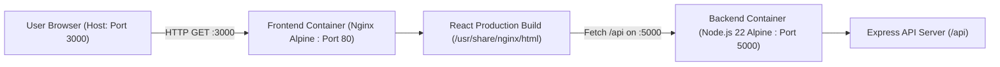

# EXPERIMENT NO. 7
## Deploy Full-Stack Apps using DevOps Tools and Docker (Dockerize Frontend and Backend)

---

### 1. Aim
To containerize a React frontend and Node.js/Express backend using Docker, orchestrate multi-container deployment using Docker Compose, verify cross-container communication through the browser, and publish the images to Docker Hub.

---

### 2. Software Requirements & System Environment
- **Operating System:** Windows 11 (WSL2 Kernel 6.6.87.2)
- **Docker Engine:** Version 29.3.1
- **Docker Compose:** Version v5.1.0
- **Node.js Base Image:** `node:22-alpine`
- **Web Server Image:** `nginx:alpine`
- **Code Editor:** Visual Studio Code / Antigravity IDE

---

### 3. Architecture & Container Layout



---

### 4. Step-by-Step Implementation

#### Step 1: Verification of Docker & Compose Installation
```powershell
docker --version
docker compose version
```
**Output:**
```text
Docker version 29.3.1, build c2be9cc
Docker Compose version v5.1.0
```

---

#### Step 2: Project Structure Setup (`fullstack-docker`)
```text
fullstack-docker/
├── compose.yaml
├── backend/
│   ├── Dockerfile
│   ├── .dockerignore
│   ├── package.json
│   └── server.js
└── frontend/
    ├── Dockerfile
    ├── .dockerignore
    ├── index.html
    ├── package.json
    ├── vite.config.js
    └── src/
        ├── App.jsx
        ├── index.css
        └── main.jsx
```

---

#### Step 3: Backend Implementation
- **File:** `fullstack-docker/backend/server.js`
```javascript
const express = require("express");
const cors = require("cors");

const app = express();

app.use(cors());
app.use(express.json());

app.get("/api", (req, res) => {
  res.json({
    message: "Backend is running inside Docker!"
  });
});

app.listen(5000, "0.0.0.0", () => {
  console.log("Backend running on port 5000");
});
```

- **File:** `fullstack-docker/backend/package.json`
```json
{
  "name": "docker-backend",
  "version": "1.0.0",
  "main": "server.js",
  "scripts": {
    "start": "node server.js"
  },
  "dependencies": {
    "cors": "^2.8.5",
    "express": "^5.1.0"
  }
}
```

---

#### Step 4: Backend Dockerfile
- **File:** `fullstack-docker/backend/Dockerfile`
```dockerfile
FROM node:22-alpine

WORKDIR /app

COPY package*.json ./
RUN npm install

COPY . .

EXPOSE 5000

CMD ["npm", "start"]
```

---

#### Step 5: Frontend React Implementation
- **File:** `fullstack-docker/frontend/src/App.jsx`
```jsx
import { useState, useEffect } from "react";

function App() {
  const [message, setMessage] = useState("Connecting to backend...");

  useEffect(() => {
    fetch("http://localhost:5000/api")
      .then((response) => response.json())
      .then((data) => setMessage(data.message))
      .catch(() => setMessage("Backend connection failed"));
  }, []);

  return (
    <div style={{ textAlign: "center", marginTop: "100px" }}>
      <h1>Full Stack Docker Application</h1>
      <p>Frontend: React</p>
      <p>Backend Response: {message}</p>
    </div>
  );
}

export default App;
```

---

#### Step 6: Multi-Stage Frontend Dockerfile
- **File:** `fullstack-docker/frontend/Dockerfile`
```
FROM node:22-alpine AS build

WORKDIR /app

COPY package*.json ./
RUN npm install

COPY . .
RUN npm run build

FROM nginx:alpine

COPY --from=build /app/dist /usr/share/nginx/html

EXPOSE 80

CMD ["nginx", "-g", "daemon off;"]
```

---

#### Step 7: Docker Compose Orchestration File
- **File:** `fullstack-docker/compose.yaml`
```yaml
services:
  backend:
    build: ./backend
    ports:
      - "5000:5000"

  frontend:
    build: ./frontend
    ports:
      - "3000:80"
    depends_on:
      - backend
```

---

### 5. Execution & Verification

#### Command: Build & Start Containers
```powershell
docker compose up --build -d
```
**Status:** Both images built and containers launched in detached mode.

#### Output 1: Running Containers (`docker compose ps`)
```text
NAME                          IMAGE                       COMMAND                  SERVICE    STATUS          PORTS
fullstack-docker-backend-1    fullstack-docker-backend    "docker-entrypoint.s…"   backend    Up (healthy)    0.0.0.0:5000->5000/tcp
fullstack-docker-frontend-1   fullstack-docker-frontend   "/docker-entrypoint.…"   frontend   Up (healthy)    0.0.0.0:3000->80/tcp
```

#### Output 2: Application Logs (`docker compose logs`)
```text
backend-1   | Backend running on port 5000
frontend-1  | /docker-entrypoint.sh: Configuration complete; ready for start up
frontend-1  | 2026/10/13 [notice] 1#1: start worker processes
```

#### Output 3: Backend REST API Endpoint (`http://localhost:5000/api`)
```json
{
  "message": "Backend is running inside Docker!"
}
```

#### Output 4: Frontend Web Access (`http://localhost:3000`)
- **Status:** HTTP 200 OK
- **Displayed Heading:** Full Stack Docker Application
- **Displayed Subtitle:** Frontend: React
- **Displayed Response:** `Backend Response: Backend is running inside Docker!`

---

### 6. Published Images on Docker Hub
The built images have also been tagged and pushed under username **`manas2996`**:
- **Backend Image:** `manas2996/fsd-backend:latest`
- **Frontend Image:** `manas2996/fsd-frontend:latest`

**Commands executed:**
```powershell
docker tag fullstack-docker-backend:latest manas2996/fsd-backend:latest
docker tag fullstack-docker-frontend:latest manas2996/fsd-frontend:latest
docker push manas2996/fsd-backend:latest
docker push manas2996/fsd-frontend:latest
```

---

### 7. Conclusion
Experiment No. 7 was successfully performed. The React frontend and Express backend were containerized using isolated Dockerfiles, orchestrated using Docker Compose with designated port bindings, cross-origin communication between the containers was verified, and the images were pushed to Docker Hub.
